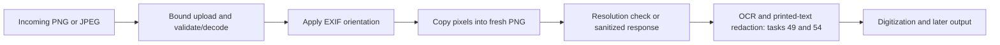

# Task #48 — Strip metadata from incoming EKG images

[Taiga task](https://tree.taiga.io/project/gshale-sprint-0-backlog/task/48),
story #12. Owner: Vansh. Implementation verified locally on October 26, 2026.

## Problem and result

A photo can contain location, timestamps, a device name, or patient information
outside its visible pixels. Passing the original file to analysis also passes
those hidden fields. The upload service now rebuilds every accepted static PNG
or JPEG from decoded pixels before resolution checking or a downstream handoff.
The result is a fresh PNG containing only its image header, compressed pixels,
and end marker. Structural dimensions are still necessary to decode an image;
"metadata-free" here means no inherited ancillary/identifying fields.

## Processing contract

Only validation, decoding, and the orientation needed to preserve the image
occur before sanitization. No OCR, geometric crop, waveform extraction, storage,
or external call is made by this stage.

| Interface | Contract |
| --- | --- |
| `sanitize_image(data)` | Pure service function; returns `SanitizedImage` with safe PNG bytes, dimensions, and source format. Bytes are hidden from its `repr`. Raises a fixed safe `SanitizationError` on failure. |
| `POST /uploads` | Existing `201` JSON summary now runs sanitization first; source `media_type`/`size_bytes` fields retain their original meaning, while new `sanitized_*` fields describe the output. Width/height are orientation-applied. |
| `POST /uploads/sanitize` | `200 image/png`; actual sanitized bytes, fixed download filename, `Cache-Control: no-store`, `nosniff`. No saved artifact or lookup ID. |

Both endpoints accept one multipart `file` field. The reported source format
comes from the bytes, not the client's filename or MIME type. Every response
that describes privacy distinguishes `embedded_metadata_removed: true` from
`printed_identifiers_redacted: false`.

## Implementation decisions

- **Rebuild instead of deleting known tags.** A denylist can miss private fields.
  A fresh Pillow image receives only pixels; inherited EXIF/GPS, XMP, IPTC,
  comments, profiles, thumbnails, PNG text/private chunks, and trailing bytes do
  not enter the output encoder. This implements the image-rewriting approach
  described in the [OWASP upload guidance](https://cheatsheetseries.owasp.org/cheatsheets/File_Upload_Cheat_Sheet.html).
- **Preserve orientation before dropping EXIF.** Otherwise a phone image can
  rotate after sanitization. All eight orientation cases are tested. See
  [Pillow's orientation behavior](https://pillow.readthedocs.io/en/stable/reference/ImageOps.html#PIL.ImageOps.exif_transpose).
- **Encode PNG for both sources.** It avoids adding JPEG artifacts. The tests
  compare decoded pixels, not compressed file equality. Existing compression
  damage in an input JPEG cannot be undone.
- **Preserve useful pixel detail.** RGB and alpha remain, palette transparency
  becomes explicit pixels, and 16-bit grayscale remains 16-bit. CMYK JPEGs become
  RGB. ICC profiles are removed, so color-managed appearance can differ; this
  does not promise clinical/colorimetric equivalence. These conversions follow
  [Pillow's supported formats](https://pillow.readthedocs.io/en/stable/handbook/image-file-formats.html).
- **Fail closed.** Static PNG/JPEG only. DICOM files (including the usual DICM
  signature), PDF, GIF, HEIC, and animated/multi-frame images are rejected rather
  than forwarded. Native DICOM needs a separately reviewed tag, private-element,
  multi-frame, and burned-in-text policy. No DICOM de-identification is claimed.

## Limits and errors

Input file: 10 MiB; whole multipart request: 10 MiB + 64 KiB; decoded image:
50,000,000 pixels; encoded output: 64 MiB. The actual received request stream is
bounded even if `Content-Length` lies. Multipart file parts remain below the
configured in-memory spool threshold and close on success or parse failure.
Pixel decode/encode runs in the thread pool rather than on the ASGI event loop.

| Failure | HTTP status |
| --- | --- |
| Missing `Content-Length` | 411 |
| Invalid length, empty upload, malformed multipart | 400 |
| Request/file/pixel/output limit exceeded | 413 |
| Unsupported image/container or animation | 415 |
| Missing file or corrupt image/metadata | 422 |

These are per-request safeguards. Decoded images can still use considerable RAM;
production needs worker/concurrency limits and admission controls. The current
local prototype has no authentication or HTTPS and should use synthetic data.
Python/Pillow memory is released through normal object lifetime; secure memory
erasure is not guaranteed. An operating system may page process memory.

## Handoff to #51

For a Python pipeline, call `sanitize_image(original_bytes)` once at its input
boundary, then pass **only `result.data`** to OCR/redaction/preprocessing. For an
HTTP integration, submit to `/uploads/sanitize` and use the returned PNG bytes.
The result still contains any names printed in its pixels; #49/#54 must handle
those before export or analysis that requires de-identified content.

No capture-screen file was changed for this task. The browser's existing local
crop preview is still a separate path; #51 must place this boundary before any
raw upload reaches further server processing. If that integration sends crop
corners, use orientation-applied source coordinates and avoid applying a second
geometric warp to an already warped preview.

## Acceptance evidence and remaining work

Tests check actual PNG chunk names, metadata marker absence, decoded waveform
pixels, all orientations, transparency and precision, idempotence, corrupt and
unsupported input, request limits, no disk spooling, fixed filenames, safe logs,
and failed sanitization returning an error instead of an accepted upload.
Run the commands in [the verification record](verification-2026-10-26.md).

Implemented for the existing PNG/JPEG service boundary. Team acceptance of that
format scope, #51 end-to-end integration, production transport/access controls,
and any future DICOM ingestion remain explicit follow-ups.
